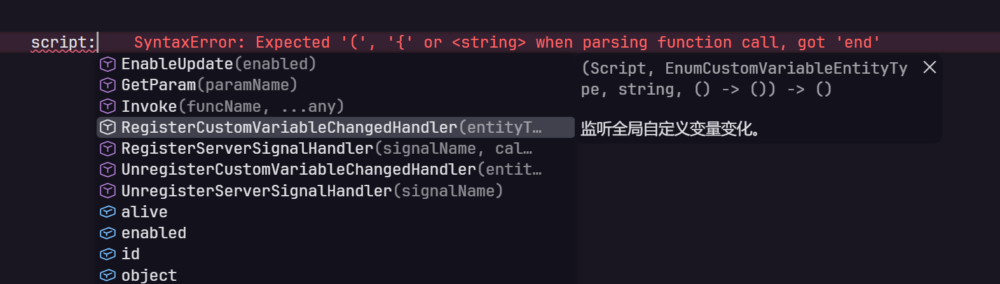

# 千星奇域 Lua LSP

在 VS Code 里编写《原神》千星奇域脚本时，输入 `game.` 就能浏览可用的 API。扩展为 `.lua` 和 `.luau` 文件提供控件与枚举补全、中文悬停说明和参数类型检查，也能带你跳到项目中引用的模块定义。



## 安装

需要 VS Code 1.74 或更高版本。每个安装包都内置了适配千星奇域的 Lua 语言服务，只需下载与你的 VS Code 平台匹配的一个包。

1. 打开项目的 [Releases 页面](https://github.com/HarukaTea/Miliastra-Lua-Lsp/releases)，找到最新发布的版本。
2. 展开该版本的 **Assets**，按下表下载与你的平台匹配的 `.vsix` 安装包。
3. 在 VS Code 的「扩展」面板打开右上角的 **⋯** 菜单，选择 **从 VSIX 安装…**，然后选中下载的 `.vsix` 文件。

| 你的平台 | 安装包 |
| --- | --- |
| Windows x64 | `miliastra-win32-x64.vsix` |
| macOS（Apple 芯片，ARM64） | `miliastra-darwin-arm64.vsix` |
| Linux x64 | `miliastra-linux-x64.vsix` |

## 试一下控件补全

用 VS Code 打开脚本所在的文件夹，新建一个 `main.lua`，输入第一行。接着在第二行输入 `panel:`，从补全列表选中 `SetVisible`。

```lua
local panel = game.FindClientUIRoot("HUD")
panel:SetVisible(true)
```

把鼠标停在 `SetVisible` 上，可以看到它接收一个布尔值，以及中文说明「仅设置可见性，不停止脚本逻辑。」这个示例可以直接在编辑器里试。要在游戏里运行，请把 `HUD` 换成场景中已有的 UI 根控件名称。

## 跨文件跳转和类型检查

- 如果工作区里有 `ui/panel.lua`，用 `local panel = require("ui.panel")` 引入它，就能在调用处对它导出的字段按 **F12** 跳到定义。模块放在 `scripts/ui/panel.lua` 时，可在设置 `miliastraLsp.runtime.path` 的列表中追加 `scripts/?.lua`。
- 在脚本首行写上 `--!strict` 可启用 Lua 脚本的严格类型检查。例如，把上面示例的 `true` 改成字符串 `"true"`，就能在「问题」面板看到参数类型错误。工作区的类型检查和 lint 规则可以放在根目录的 `.luaurc` 中。
- 千星奇域脚本中的 `&`、`|`、`<<`、`>>` 等位运算也支持静态检查。要调整补全、诊断或内联类型提示，在 VS Code 设置中搜索 `miliastraLsp`。

## 常见问题

**已经安装了 Luau Language Server，还需要保留它吗？** 本扩展可以独立使用。如果在千星奇域项目里看到两份补全或重复诊断，可在扩展面板找到 JohnnyMorganz 发布的 **Luau Language Server**，通过齿轮菜单选择 **禁用（工作区）**。其他项目仍可使用它。

**从旧版升级后，为什么提示变了？** 此版本采用新的类型检查与 lint 规则。如果脚本依赖 EmmyLua 注解，或项目配置了旧版 Lua 诊断规则，请核对升级后的提示。

**怎样反馈缺失的 API 或错误提示？** 请提供一段能重现问题的 Lua 代码，并写明预期看到的签名或提示。[提交问题](https://github.com/HarukaTea/Miliastra-Lua-Lsp/issues) · [贡献指南](CONTRIBUTING.md)

## 许可

本项目采用 [MIT 许可证](LICENSE)。随包分发的 luau-lsp、Luau 及其他原生组件的署名与许可见[第三方声明](server/THIRD-PARTY-NOTICES.txt)。
